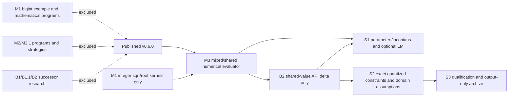

# Genetik 0.7.0 Development Pre-release — Preparation and Qualification

> **Historical preparation record.** The branch, draft-PR, authorization, and
> unpublished-status statements below describe the pre-publication S3
> qualification period. Genetik 0.7.0 is now integrated on `main` and published
> as a GitHub development pre-release. Current release scope and migration
> guidance are in [0.7.0 release notes](releases/0.7.0/NOTES.md); the GitHub
> release page is the authority for the published asset set.

## Initial implementation qualification snapshot

The authorized release branch is `qualification/scientific-regression-s3`.
Its reviewed implementation commit
[`b0b84e5ba5975bf2397e325469e0f45645486228`](https://github.com/karlphillip/Genetik/commit/b0b84e5ba5975bf2397e325469e0f45645486228)
passed the complete six-job [hosted workflow 41170361397](https://github.com/karlphillip/Genetik/actions/runs/41170361397).
The job links are [GCC 13 x64 / CMake 3.16](https://github.com/karlphillip/Genetik/actions/runs/41170361397/job/124446801244),
[Clang 18 x64 ASan+UBSan](https://github.com/karlphillip/Genetik/actions/runs/41170361397/job/124446801301),
[GCC 13 ARM64 plus TSan](https://github.com/karlphillip/Genetik/actions/runs/41170361397/job/124446801230),
[optional math](https://github.com/karlphillip/Genetik/actions/runs/41170361397/job/124446801084),
[CPython 3.12 x64](https://github.com/karlphillip/Genetik/actions/runs/41170361397/job/124446801415),
and [CPython 3.12 ARM64](https://github.com/karlphillip/Genetik/actions/runs/41170361397/job/124446801252).
All six completed successfully.

| Hosted artifact | Artifact ID | Identity / SHA256 |
|---|---:|---|
| [native-gcc13-x64-minimum](https://github.com/karlphillip/Genetik/actions/runs/41170361397/artifacts/13030239593) | 13030239593 | GCC 13, Ubuntu 24.04 x86-64, Release, CMake/CTest 3.16.0 |
| [native-clang18-x64-sanitizers](https://github.com/karlphillip/Genetik/actions/runs/41170361397/artifacts/13031132296) | 13031132296 | Clang 18, Ubuntu 24.04 x86-64, Debug ASan+UBSan |
| [native-gcc13-arm64](https://github.com/karlphillip/Genetik/actions/runs/41170361397/artifacts/13031302291) | 13031302291 | GCC 13, Ubuntu 24.04 AArch64, Release and TSan evidence |
| [optional-math-gcc13-x64](https://github.com/karlphillip/Genetik/actions/runs/41170361397/artifacts/13030872291) | 13030872291 | Optional exact-rational and LP64 numerical contracts |
| [python-cp312-x86_64](https://github.com/karlphillip/Genetik/actions/runs/41170361397/artifacts/13031265699) | 13031265699 | x86-64 wheel `04bfb96dde1336b89b2f6d8d62f59c395dbd2d51f1f50a0b153e45f1da817e31`; shared sdist `efe0b0e5711816c0b9a04a7417954f5a0afbc4a5b329482998dda293ecb99beb` |
| [python-cp312-aarch64](https://github.com/karlphillip/Genetik/actions/runs/41170361397/artifacts/13030782104) | 13030782104 | AArch64 wheel `6eadedc1db1ff7f626ab316f7a0a85e3ab42bec4d7361ac063af94035f354795`; shared sdist `efe0b0e5711816c0b9a04a7417954f5a0afbc4a5b329482998dda293ecb99beb` |

Both Python workflow artifacts contain the same exact-tip source archive,
`Genetik-0.7.0-source.tar.gz`, SHA256
`a0e0c4eec7e52438292f07415b108868f63732dc6884d8e8229a08b43b23a085`, and
the source `SHA256SUMS` file. The wheel tags are host-specific CPython 3.12
Linux tags, not manylinux. These artifact links follow GitHub's configured
14-day retention. Any follow-on documentation commit must be validated at its
own exact SHA; the workflow regenerates its source archive and checksum files.

At the time of this preparation snapshot, the working release remained
unpublished. A draft PR was authorized for review; merge, tag operations,
GitHub Release publication, PyPI upload, and changes to published v0.6.0 assets
were outside that snapshot's authorization.

## Integration audit

The first-parent history from the published v0.6.0 tag to the S2 source contains M1, M2/M2.1, M3, B1/B1.1/B2, S1 and S2. The S3 release candidate is deliberately based on v0.6.0 and does not merge that whole ancestry. It cherry-picks the original M3, S1 and S2 patches as new reviewed integration commits and adds only M1 `BoundedBigInteger.hpp` and the integer square/root evaluator kernels that the exact-rational backend and `MixedExpression` directly call. The exact integration sequence is recorded in `docs/s3-results/integration-audit.tsv`.

| History category | S3 candidate decision | Dependency finding |
|---|---|---|
| Required mathematical infrastructure | Include M1 `BoundedBigInteger.hpp` for exact rationals and its `DiscreteExpression`/`AdvancedInteger` integer sqrt/root kernel delta | `MixedExpression.hpp` calls `genetik_discrete_detail::integerMath` for its integer square-root operation. `BoundedBigInteger.hpp` is needed by `BoundedRational.hpp`; the bounded-bigint example and mathematical-program API are not needed. |
| Mixed numerical expressions | Include the M3 evaluator. | Required by the mixed numerical regression API. |
| Shared Real64 parameter value/evaluation infrastructure | Transplant only `MixedExpression.hpp`, `MixedRegression.hpp`, and `MixedIntegerCheckpoint.hpp` changes from B2 commit `e6046fe`. | The S2 exact Wythoff witness requires parameter identity, explicit parameter values, and parameter-aware evaluation. The B2 gap solver, evolutionary variation, campaigns, and findings are excluded. |
| Parameter differentiation and optional LM | Include S1 | Consumes mixed shared-parameter identities; coordinate fitting stays the default. |
| Exact rational arithmetic, quantized constraints and domain-aware algebra | Include S2 and its narrowly updated `SymbolicAlgebra.hpp` | Consumes shared parameter identities and exact bounded rational interval logic. |
| Mathematical-program research | Exclude M1 `MathematicalProgram.hpp` and M2/M2.1 evolution/readiness APIs | No include, link or runtime dependency from M3, S1 or S2. |
| Prime and successor discovery | Exclude M1 campaign, B1/B1.1/B2 campaigns, apps and outputs | These are experiments, not mathematical evaluator or S1/S2 dependencies. No prime-successor campaign is part of S3. |
| Research-only evolutionary strategies | Exclude the M2/M2.1 strategy and readiness implementation | Does not enter the qualified scalar/mixed regression path. |
| Qualification and historical evidence | Keep S1/S2 evidence and the 127-file frozen evidence inventory; leave all other research evidence on its existing commits/branches | No historical commit, tag, branch or evidence record is rewritten or removed. |

The curated integration commits currently resolve as follows (the final S3 commit follows S2):

| Order | Candidate commit | Original research commit | Scope |
|---:|---|---|---|
| 0 | `3f0815c94f3ea5968233a01b95cf070ec7f71ae0` | published tag `v0.6.0` | Release baseline |
| 1 | `9b7ded1` | `6570ff456a16a2e4cd565560e5a2c8978f53b1fe` | M3 mixed numerical/shared-parameter support |
| 2 | `6de661f` | `ed0225e` | M1 integer sqrt/root kernel delta only |
| 3 | `5f8f384` | `ed0225e` | M1 `BoundedBigInteger.hpp` dependency only |
| 4 | `0c9af5f` | `7e73bee18e0660383d1dfeef7ba7e97323a41fc2` | S1 derivatives and optional LM |
| 5 | `69c0a91` | `31c131b5b2e185ec82476e5b0b317af83bee3978` | S2 rational constraints and domain assumptions |
| 6 | `c52f026` | three-file source transplant from `e6046fe` | Shared parameter values/evaluation/checkpoint identity only; B2 search code excluded |
| 7 | `ecfaf20` | S3 | Equation archive, 0.7 metadata, release documentation and v0.6 checkpoint compatibility |
| 8 | `ee9d82f` | S3 | Frozen external benchmark protocol |

These are new commits on the local candidate branch; original commits and their research branch remain intact. The reviewed candidate graph is:

The reviewed source/export tree contains no mathematical-program discovery/readiness headers or prime/successor applications. Original research branches and their history remain unchanged. The package's existing CMake install rule exports headers present in the candidate tree; it no longer accidentally exports those excluded research headers because they are absent from the curated tree.

## Optional dependencies and platform boundary

Ordinary Genetik remains C++20 and standard-library-only. Exact rational code uses Boost.Multiprecision 1.83, under the Boost Software License 1.0. Its public optional headers expose Boost types; `Genetik::Genetik` does not find, link, or propagate Boost, so clients that include those headers must provide Boost headers themselves. D6's LP64 LAPACK backend is opt-in through `Genetik::ScientificNumerics`; that imported interface target propagates `GENETIK_HAS_LAPACK` and the LAPACK link libraries. The local qualified backend is OpenBLAS 0.3.26 / system LP64 LAPACK on Linux AArch64, under the upstream BSD-style licenses. Neither optional dependency is required by the ordinary installed package. Python is optional and built with pybind11 2.13.6 as a private extension dependency. Hosted wheel/sdist evidence covers CPython 3.12.3 on Ubuntu 24.04 x86-64 and AArch64; other Python minor versions and operating systems remain unqualified.

The 0.7.0 candidate keeps generic checkpoint decoding exact-version and adds explicit scalar/discrete forward readers for published 0.6.0 alongside the existing 0.5.0, 0.4.0 and 0.3.0 policies. This is now covered by fixtures containing the historical v0.6.0 version/checkpoint headers from the exact published tag; the 0.7 compatibility tests compare resumed trajectories and reject wrong codec/runtime inputs.

## Output-only equation archive

`genetik/EquationArchive.hpp` defines `EquationRecord` and bounded `EquationArchive` (record count, per-record text, and total text limits). Construct records offline from authoritative training measurements. Insert filters invalid/nonfinite/negative-loss records, uses strict two-objective dominance on training loss and expression complexity, collapses only identical canonical strings (metadata ties resolve by loss, complexity, constant count, constant-description length, presentation text, then constraints), orders by loss then complexity then canonical string, and applies deterministic count and text-byte capacity limits. Distinct canonical strings remain distinct even when sampled predictions match. JSON Lines preserves full double precision and includes constants metadata, canonical and presentation expressions, and constraints. Text output carries presentation expressions and assumptions. Pretty/LaTeX strings are caller-supplied presentation only. The archive is not connected to population, fitness, RNG, selection, survivor retention, objective accounting or checkpoints, so enabling/reporting it has no evolutionary lifecycle call site. It uses training records only by construction.

## Version/artifacts and authorization boundary

The candidate identifies as 0.7.0 in C++ and Python package metadata. Hosted
CPython 3.12.3 x86-64 and AArch64 wheels and the sdist passed the Python
interoperability checks (including documented platform-conditional skips). The
Python build uses scikit-build-core 0.10.7 and pybind11 2.13.6; the native C++
package also passed exact-CMake-3.16.0 qualification. These are host-tagged
artifacts, not manylinux or cross-platform claims. Artifact links and checksums
for implementation commit `b0b84e5` appear in the current qualification status.

The later draft-PR review commit required its own complete hosted run, which
regenerated the exact-tip source archive and checksum manifests. These
host-tagged artifacts do not qualify other Python versions, manylinux
compatibility, or other operating systems.

## Earlier integrated-source qualification (source `c52f026`)

The corrected integrated source passed Release **99/99**, Debug **69/69**, exact CMake **3.16.0 Release 69/69**, ASan+UBSan **69/69**, and the required TSan selection **9/9**. Exact Boost rational contracts passed **1/1**; separately built optional public headers passed standalone compilation. Optional LAPACK/OpenBLAS D6 contracts and package consumer passed **3/3**. Per-configuration test-name manifests are in `docs/s3-results/test-manifests/manifest.json`; configuration-specific full logs are retained under `docs/s3-results/final-*` and `cmake316-final-*`. The suites cover strict floating-point policy, standalone headers, generic OOP isolation, checkpoint/replay and deterministic continuation, parameter-identity and optimizer configuration checks, mathematical contracts, and archive contracts. Existing scalar/discrete checkpoints from v0.6.0 were read with trajectory compatibility checks; generic checkpoint decoding remains exact-version. Dependent header-only translation units require recompilation. The regular C++ target has no Boost/LAPACK link dependency; optional dependency consumers were separately built and installed.

Historical intermediate runs are retained but not pooled with those results: the 66-test first curated Release run preceded the archive and v0.6 compatibility fixture integration, the 75-test pre-curation S2 tree is outside this release scope, and the first CMake 3.16 invocation used an unsupported `--test-dir` switch. The 127 frozen evidence files were verified unchanged against the curated source.

The earlier local Python wheel/sdist under `out/release/s3/` are historical
build outputs. Exact-tip source archives, wheels, sdists and checksum manifests
for the hosted implementation commit are linked above; the documentation
follow-up must regenerate them through its own workflow run. The exact 108-run
external results and independent held-out scoring remain in
`S3_SCIENTIFIC_BENCHMARKS.md` and `docs/s3-results/external-comparison/`.
Repository hygiene passes; `--workspace` also reports unrelated preserved
parent-workspace material in this curated `out/tmp` checkout.

## Authorization boundary

The following matrix description records the hosted scope requested for
implementation commit `b0b84e5ba5975bf2397e325469e0f45645486228`; it has now
executed successfully, as linked above:

| Hosted job | Completed qualification |
|---|---|
| GCC 13 x86-64, minimum CMake 3.16.0 | Release manifest, installed/relocated consumers, standalone headers and multi-translation-unit checks |
| Clang 18 x86-64 ASan+UBSan | Instrumented build and complete applicable native suite |
| GCC 13 AArch64 | Release suite, required TSan selections and optional LAPACK package contract |
| Optional math, GCC 13 x64 | Exact rational and optional numerical package contracts |
| CPython 3.12 x86-64 | Build host-tagged wheel and sdist from the named source; install outside checkout and run Python interoperability tests |
| CPython 3.12 AArch64 | Build host-tagged wheel and sdist from the named source; install outside checkout and run Python interoperability tests |

That initial hosted qualification did not include main integration, tagging,
or publication. Those steps were completed separately after this snapshot;
PyPI upload and changes to published v0.6.0 assets remain outside the release
scope.
