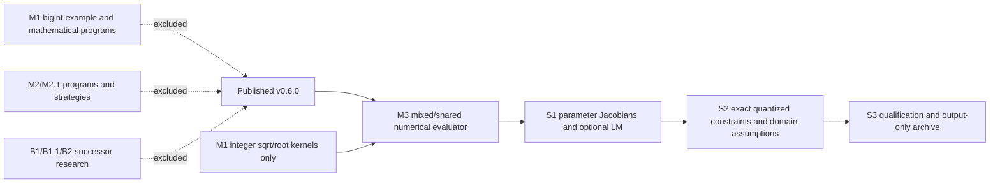

# Genetik 0.7.0 Development Pre-release — Preparation

## Integration audit

The first-parent history from the published v0.6.0 tag to the S2 source contains M1, M2/M2.1, M3, B1/B1.1/B2, S1 and S2. The S3 release candidate is deliberately based on v0.6.0 and does not merge that whole ancestry. It cherry-picks the original M3, S1 and S2 patches as new reviewed integration commits and adds only M1 `BoundedBigInteger.hpp` and the integer square/root evaluator kernels that the exact-rational backend and `MixedExpression` directly call. The exact integration sequence is recorded in `docs/s3-results/integration-audit.tsv`.

| History category | S3 candidate decision | Dependency finding |
|---|---|---|
| Required mathematical infrastructure | Include M1 `BoundedBigInteger.hpp` for exact rationals and its `DiscreteExpression`/`AdvancedInteger` integer sqrt/root kernel delta | `MixedExpression.hpp` calls `genetik_discrete_detail::integerMath` for its integer square-root operation. `BoundedBigInteger.hpp` is needed by `BoundedRational.hpp`; the bounded-bigint example and mathematical-program API are not needed. |
| Mixed numerical expressions and shared Real64 parameters | Include M3 `MixedExpression.hpp`, `MixedRegression.hpp` and `MixedIntegerCheckpoint.hpp` | Required by S1 parameter identity and derivative/fitting support. |
| Parameter differentiation and optional LM | Include S1 | Consumes mixed shared-parameter identities; coordinate fitting stays the default. |
| Exact rational arithmetic, quantized constraints and domain-aware algebra | Include S2 and its narrowly updated `SymbolicAlgebra.hpp` | Consumes shared parameter identities and exact bounded rational interval logic. |
| Mathematical-program research | Exclude M1 `MathematicalProgram.hpp` and M2/M2.1 evolution/readiness APIs | No include, link or runtime dependency from M3, S1 or S2. |
| Prime and successor discovery | Exclude M1 campaign, B1/B1.1/B2 campaigns, apps and outputs | These are experiments, not mathematical evaluator or S1/S2 dependencies. No prime-successor campaign is part of S3. |
| Research-only evolutionary strategies | Exclude the M2/M2.1 strategy and readiness implementation | Does not enter the qualified scalar/mixed regression path. |
| Qualification and historical evidence | Keep S1/S2 evidence and the 127-file frozen evidence inventory; leave all other research evidence on its existing commits/branches | No historical commit, tag, branch or evidence record is rewritten or removed. |

The curated integration commits currently resolve as follows (the final S3 commit follows S2):

| Order | Candidate commit | Original research commit | Scope |
|---:|---|---|---|
| 0 | `3f0815c94f3ea5968233a01b95cf070ec7f71ae0` | published tag `v0.6.0` | Release baseline |
| 1 | `9b7ded1` | `6570ff456a16a2e4cd565560e5a2c8978f53b1fe` | M3 mixed numerical/shared-parameter support |
| 2 | `6de661f` | `ed0225e` | M1 integer sqrt/root kernel delta only |
| 3 | `5f8f384` | `ed0225e` | M1 `BoundedBigInteger.hpp` dependency only |
| 4 | `0c9af5f` | `7e73bee18e0660383d1dfeef7ba7e97323a41fc2` | S1 derivatives and optional LM |
| 5 | `69c0a91` | `31c131b5b2e185ec82476e5b0b317af83bee3978` | S2 rational constraints and domain assumptions |

These are new commits on the local candidate branch; original commits and their research branch remain intact. The reviewed candidate graph is:

The reviewed source/export tree contains no mathematical-program discovery/readiness headers or prime/successor applications. Original research branches and their history remain unchanged. The package's existing CMake install rule exports headers present in the candidate tree; it no longer accidentally exports those excluded research headers because they are absent from the curated tree.

## Optional dependencies and platform boundary

Ordinary Genetik remains C++20 and standard-library-only. Exact rationals use Boost.Multiprecision 1.83 in the retained qualification; the public optional rational headers include Boost types, but `Genetik::Genetik` neither finds nor propagates Boost, so exact clients must supply that include dependency themselves. D6's LP64 LAPACK target is separately opt-in through `Genetik::ScientificNumerics`; its imported target propagates the compile definition and LAPACK link dependency. The local qualified backend is OpenBLAS 0.3.26 / system LP64 LAPACK on Linux AArch64. Ordinary builds and installed package clients do not require LAPACK. Python remains optional; package metadata is provisionally 0.7.0 and the final sdist/wheel build is a separate gate. Existing supported-platform limits remain those in `docs/SUPPORT.md`.

The 0.7.0 candidate keeps generic checkpoint decoding exact-version and adds explicit scalar/discrete forward readers for published 0.6.0 alongside the existing 0.5.0, 0.4.0 and 0.3.0 policies. This is now covered by fixtures containing the historical v0.6.0 version/checkpoint headers from the exact published tag; the 0.7 compatibility tests compare resumed trajectories and reject wrong codec/runtime inputs.

## Output-only equation archive

`genetik/EquationArchive.hpp` defines `EquationRecord` and bounded `EquationArchive` (record count, per-record text, and total text limits). Construct records offline from authoritative training measurements. Insert filters invalid/nonfinite/negative-loss records, uses strict two-objective dominance on training loss and expression complexity, collapses only identical canonical strings (metadata ties resolve by loss, complexity, constant count, constant-description length, presentation text, then constraints), orders by loss then complexity then canonical string, and applies deterministic count and text-byte capacity limits. Distinct canonical strings remain distinct even when sampled predictions match. JSON Lines preserves full double precision and includes constants metadata, canonical and presentation expressions, and constraints. Text output carries presentation expressions and assumptions. Pretty/LaTeX strings are caller-supplied presentation only. The archive is not connected to population, fitness, RNG, selection, survivor retention, objective accounting or checkpoints, so enabling/reporting it has no evolutionary lifecycle call site. It uses training records only by construction.

## Version/artifacts and authorization boundary

The candidate now identifies provisionally as 0.7.0 in C++ and Python package metadata. Do not create final artifact identities until all code and metadata are frozen and qualified. The planned local package includes source archive, SHA256 manifest, extracted-source build/install/relocation evidence, release notes, migration guidance and qualification reports. No remote write, push, PR, tag or publication is authorized. A later hosted qualification request will name the exact local source/archive SHA and CI matrix. PR integration, tagging and publication require separate authorization.

## Engineering qualification state

The curated S3 candidate compiles with the ordinary dependency-free C++20 build. Its integrated Release manifest has 69 tests; all 69 passed, including the extracted-source install/relocation consumers, strict floating-point policy, standalone headers, generic OOP, checkpoint/replay, continuation, S1/S2 mathematical tests, v0.6 scalar/discrete checkpoint producer-consumer fixtures, D6 scientific contracts and the equation archive contracts. Evidence is `docs/s3-results/curated-s3-build.log`, `curated-s3-test-manifest.json`, and `curated-s3-ctest.log`.

The 66/66 first curated Release run preceded the S3 archive and v0.6 compatibility fixture integration; it is retained as an intermediate checkpoint. An earlier 75/75 run was against the pre-curation S2 source tree and is not counted for the release scope. The CMake 3.16 first invocation used an unsupported `--test-dir` switch and found no tests; the subsequent corrected 75/75 run was also against that pre-curation tree. Its outputs remain retained as diagnostic evidence, not as final candidate qualification.

Final-scope Debug, exact CMake 3.16.0, ASan+UBSan, required TSan selections, optional Boost and LAPACK consumers, Python package compatibility, and source-archive extraction/build/relocation are pending. The exact candidate manifest and every result are kept separate by build tree. Historical results are never added together to imply a final-tip pass.

## Version/artifacts and authorization boundary

The candidate now identifies provisionally as 0.7.0 in C++ and Python package metadata. Do not create final artifact identities until all code and metadata are frozen and qualified. The planned local package includes source archive, SHA256 manifest, extracted-source build/install/relocation evidence, release notes, migration guidance and qualification reports. No remote write, push, PR, tag or publication is authorized. A later hosted qualification request will name the exact local source/archive SHA and CI matrix. PR integration, tagging and publication require separate authorization.

## Remaining local gates

- Complete independent analytic/reference checks and freeze the S3 datasets, seeds, grammars, limits and measurement procedure.
- Run the full applicable local Release, Debug, exact-CMake-3.16.0, ASan+UBSan, TSan, OOP, standalone-header, strict-FP, checkpoint/replay, package relocation, multi-TU and optional dependency/Python compatibility matrix against one final SHA.
- Inspect/reuse pinned R9 competitor environments and execute only fair overlapping searches; preserve all outcomes.
- Select and implement a reviewed production source integration scope, then update version/docs and build checksummed artifacts from the exact tree.
- Reconcile preserved historical evidence hashes and run workspace/repository hygiene.

This file is a progress record, not a claim that these gates have passed.
